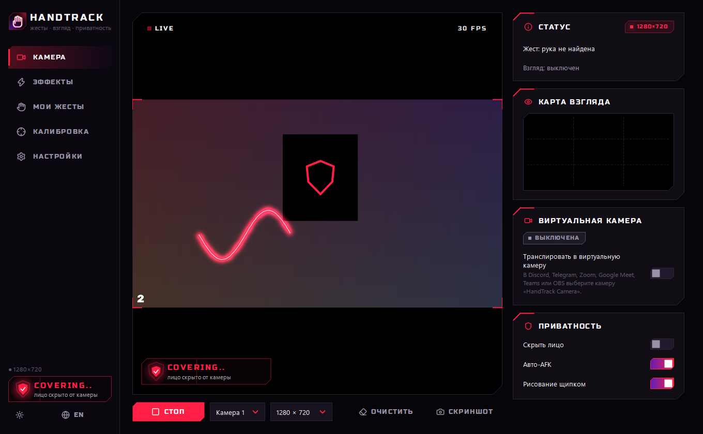

<div align="center">


# HANDTRACK — Linux

**Жесты, взгляд, скрытие лица и рисование в воздухе — прямо в ваших звонках.**
Виртуальная камера «HandTrack Camera» для Discord, Telegram, Zoom, Google Meet и OBS.

*In collaboration with [Claude](https://claude.ai).*

[⬇ Скачать](../../releases/latest) · [Пошаговая установка](HOW-TO-INSTALL.txt) · [Windows](https://github.com/OWNER/HandTrackWindows) · [macOS](https://github.com/OWNER/HandTrackMac) · [English](#english)



</div>

## Установка

1. [Releases](../../releases/latest) → **handtrack-linux-x86_64.tar.gz** → «Извлечь сюда».
2. Запустите **install.sh** (двойной щелчок; в GNOME — правой кнопкой → «Запустить как программу»).
   Права на запуск уже выставлены. Пароль спросят один раз — для виртуальной камеры.
3. HandTrack появится в меню приложений. В звонке выберите камеру **HandTrack Camera**.

Подробно: [HOW-TO-INSTALL.txt](HOW-TO-INSTALL.txt). Удаление: меню → «Удалить HandTrack»,
команда `handtrack-uninstall` или **uninstall.sh**.

Поддерживаются Ubuntu 22.04+, Debian 12+, Fedora 39+, Mint 21+, Arch, openSUSE (x86_64 и ARM64).
Камера — модуль ядра v4l2loopback из вашего дистрибутива; при Secure Boot его нужно подписать (см. инструкцию).

> Из кода (Code → Download ZIP) установщик сам поставит изолированный Python 3.12 и библиотеки
> в `~/.local/lib/handtrack` — системный Python не трогается.

## Устройство репозитория

```
install.sh / uninstall.sh   установщик и деинсталлятор
HOW-TO-INSTALL.txt          пошаговая инструкция
src/handtrack/              программа (тот же код, что и в Windows/macOS)
packaging/linux/            vcam-setup.sh (камера + библиотеки Qt), сборка релиза, спецификация PyInstaller
tests/                      тесты
```

Разработка: `pip install -r packaging/requirements-dev.txt`, `PYTHONPATH=src python -m handtrack`,
`python -m pytest`, релиз — `packaging/linux/build.sh`.

## Лицензия

[MIT](LICENSE). Сторонние компоненты — [docs/THIRD_PARTY_NOTICES.md](docs/THIRD_PARTY_NOTICES.md).

---

<a id="english"></a>

## English

Download **handtrack-linux-x86_64.tar.gz** from [Releases](../../releases/latest), extract it and run
**install.sh** (double-click, or right-click → "Run as a Program" in GNOME). Type your password once
for the virtual camera. HandTrack appears in the app menu; pick **HandTrack Camera** in your call app.
Uninstall with `handtrack-uninstall`. Step by step: [HOW-TO-INSTALL.txt](HOW-TO-INSTALL.txt).
